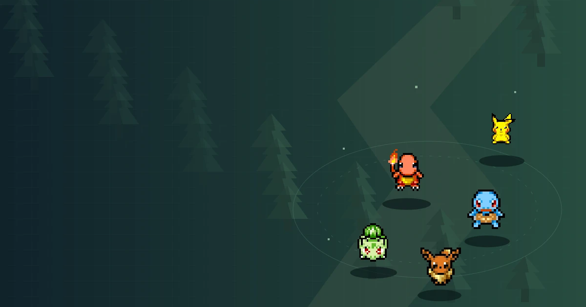
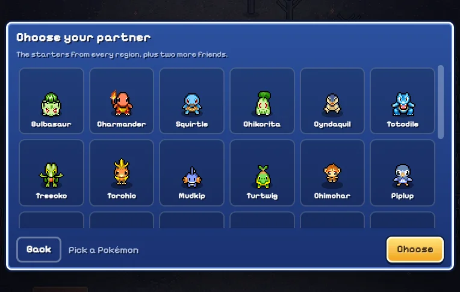
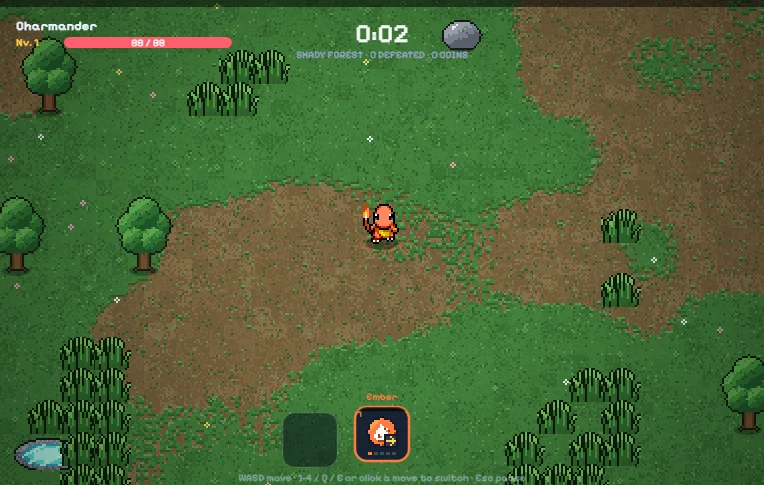
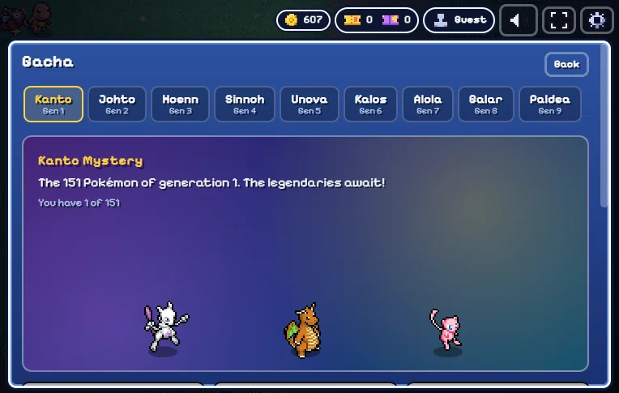

# Pokémon Survivor Wiki

[English](#english) · [繁體中文](#繁體中文)

**One more run. A little more prepared.**

[Explore pokemonsurvivor.wiki](https://pokemonsurvivor.wiki/) · [Play now](https://pokemonsurvivor.wiki/#play) · [Read the guides](https://pokemonsurvivor.wiki/guides/)

## English

Pokémon Survivor Wiki is an independent companion for JPTER78’s **PokéSurvivor** browser survival game. Choose a partner, dodge enemy crowds, collect experience and learn when to switch your active move. Find clear answers alongside a local solo game edition.

### Find the answer you need

| Your next step | Explore |
| --- | --- |
| Start your first run | [Controls and beginner guide](https://pokemonsurvivor.wiki/guides/beginner/) with actual game screenshots |
| Understand an evolution | [Moves and evolutions](https://pokemonsurvivor.wiki/moves/) — 64 moves and their requirements |
| Choose a partner | [Pokédex](https://pokemonsurvivor.wiki/pokemon/) — browse 966 Pokémon by name, type and region |
| Grow your collection | [Tickets, banners and pity](https://pokemonsurvivor.wiki/guides/gacha/) and [shiny odds](https://pokemonsurvivor.wiki/guides/shinies/) |
| Prepare for a legendary arena | [Rift conditions, rewards and bonds](https://pokemonsurvivor.wiki/guides/bosses-rifts/) |
| Solve a problem | [Loading, sound, mobile and save help](https://pokemonsurvivor.wiki/guides/save-mobile-troubleshooting/) |

### A look inside the game

*Choose a starting partner. Featured characters such as Pikachu and Eevee are collection unlocks in this version.*

*Attacks fire automatically from the active move. Keep moving, collect experience and choose upgrades deliberately.*

### Helpful extras

[Plan a legal moveset](https://pokemonsurvivor.wiki/tools/build-planner/), [compare partners](https://pokemonsurvivor.wiki/tools/compare/) and save or share a draft. These tools explain game rules; they do not promise a strongest build or a guaranteed survival time.

This edition is **local single-player**. Collection and progression stay in the current browser when storage is available; a live battle does not resume after a reload. Wiki drafts are separate from game saves. For the author’s online version, see the [co-op guide](https://pokemonsurvivor.wiki/guides/co-op/).

[Start playing](https://pokemonsurvivor.wiki/#play) · [Browse all guides](https://pokemonsurvivor.wiki/guides/) · [Contact us](https://pokemonsurvivor.wiki/contact/)

## 繁體中文

**再挑戰一局，準備得更充分。**

Pokémon Survivor Wiki 是 JPTER78 的 **PokéSurvivor** 瀏覽器生存遊戲獨立粉絲指南。選擇夥伴、避開敵群、收集經驗，並學會切換目前使用的招式。網站結合本機單人遊戲與清楚易查的攻略，幫助你理解每次選擇。

### 找到目前最需要的答案

| 你的目標 | 閱讀入口 |
| --- | --- |
| 開始第一局 | [新手與操作指南](https://pokemonsurvivor.wiki/guides/beginner/)，搭配真實遊戲畫面 |
| 了解招式進化 | [招式資料庫](https://pokemonsurvivor.wiki/moves/)，查詢 64 個招式及進化條件 |
| 選擇合適夥伴 | [寶可夢圖鑑](https://pokemonsurvivor.wiki/pokemon/)，依名稱、屬性及地區瀏覽 966 隻寶可夢 |
| 擴充收藏 | [票券、地區卡池與保底](https://pokemonsurvivor.wiki/guides/gacha/)及[異色機率](https://pokemonsurvivor.wiki/guides/shinies/) |
| 挑戰傳說競技場 | [裂隙出現條件、獎勵與羈絆](https://pokemonsurvivor.wiki/guides/bosses-rifts/) |
| 排除遊玩問題 | [載入、音效、手機與存檔說明](https://pokemonsurvivor.wiki/guides/save-mobile-troubleshooting/) |

*先確認地區卡池、票券數量及各地區獨立的保底計數，再決定如何擴充收藏。*

### 遊玩之外的小幫手

使用[配裝規劃工具](https://pokemonsurvivor.wiki/tools/build-planner/)檢查合法招式、[比較兩位夥伴](https://pokemonsurvivor.wiki/tools/compare/)，並儲存或分享草案。這些工具用來理解規則，不代表最強配裝排名，也不保證生存時間。

此版本提供**本機單人遊玩**。瀏覽器允許儲存時，收藏及成長進度會保留於目前的瀏覽器；重新載入不會恢復尚未結束的戰鬥。Wiki 草案與遊戲存檔分開管理。想使用作者的線上版本，請閱讀[合作遊玩指南](https://pokemonsurvivor.wiki/guides/co-op/)。

[開始遊玩](https://pokemonsurvivor.wiki/#play) · [瀏覽全部攻略](https://pokemonsurvivor.wiki/guides/) · [聯絡我們](https://pokemonsurvivor.wiki/contact/)

---

Game code by JPTER78 (MIT). SpriteCollab artwork is subject to CC BY-NC 4.0. Pokémon names and characters belong to their respective owners. This independent fan project is not an official Pokémon service. [Sources & credits](https://pokemonsurvivor.wiki/sources/).

遊戲程式由 JPTER78 製作（MIT），SpriteCollab 美術素材適用 CC BY-NC 4.0。寶可夢名稱與角色屬於各自權利人；本站為獨立粉絲專案，並非官方服務。[資料來源與致謝](https://pokemonsurvivor.wiki/sources/)。
