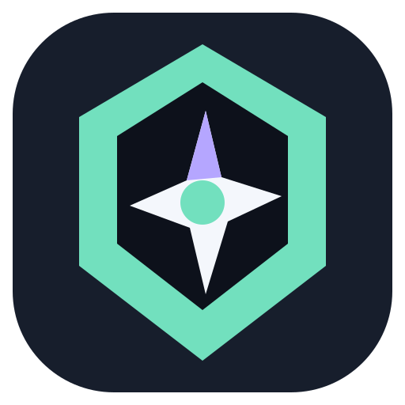
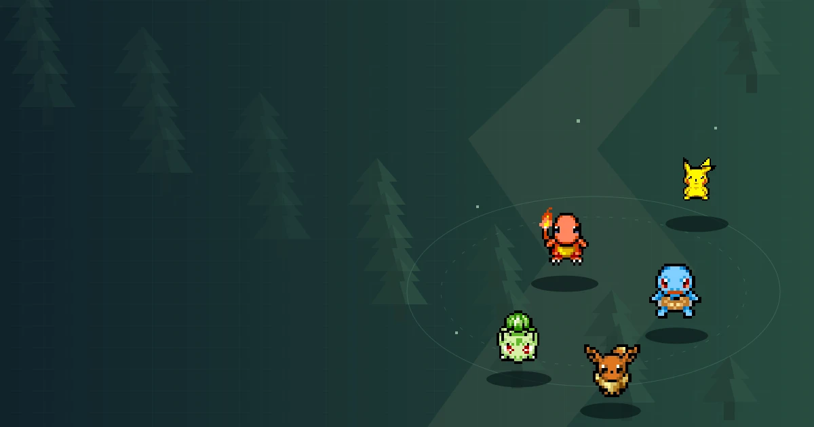
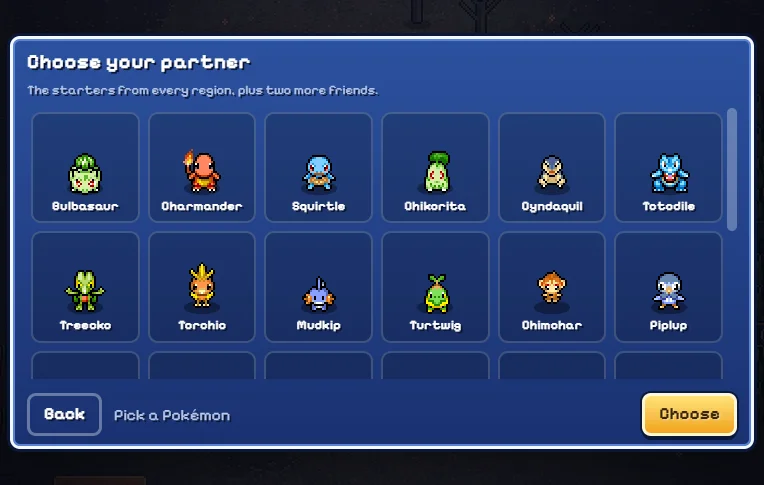
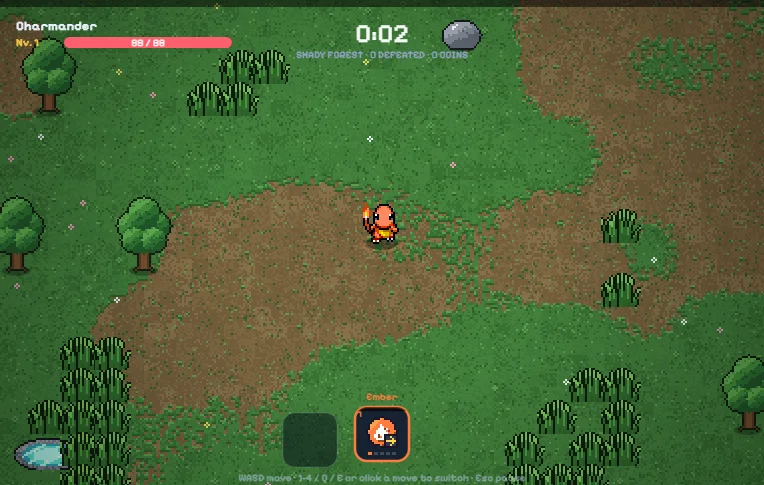

# Pokémon Survivor Wiki

**One more run. A little more prepared.**

[Explore pokemonsurvivor.wiki](https://pokemonsurvivor.wiki/) · [Play now](https://pokemonsurvivor.wiki/#play) · [Read the guides](https://pokemonsurvivor.wiki/guides/)

Pokémon Survivor Wiki is an independent companion for JPTER78’s **PokéSurvivor** browser survival game. Choose a partner, dodge enemy crowds, collect experience and learn when to switch your active move. Find clear answers alongside a local solo game edition.

### Find the answer you need

| Your next step | Explore |
| --- | --- |
| Start your first run | [Controls and beginner guide](https://pokemonsurvivor.wiki/guides/beginner/) with actual game screenshots |
| Understand an evolution | [Moves and evolutions](https://pokemonsurvivor.wiki/moves/) — 64 moves and their requirements |
| Choose a partner | [Pokédex](https://pokemonsurvivor.wiki/pokemon/) — browse 966 Pokémon by name, type and region |
| Grow your collection | [Tickets, banners and pity](https://pokemonsurvivor.wiki/guides/gacha/) and [shiny odds](https://pokemonsurvivor.wiki/guides/shinies/) |
| Prepare for a legendary arena | [Rift conditions, rewards and bonds](https://pokemonsurvivor.wiki/guides/bosses-rifts/) |
| Solve a problem | [Loading, sound, mobile and save help](https://pokemonsurvivor.wiki/guides/save-mobile-troubleshooting/) |

### A look inside the game

*Choose a starting partner. Featured characters such as Pikachu and Eevee are collection unlocks in this version.*

*Attacks fire automatically from the active move. Keep moving, collect experience and choose upgrades deliberately.*

### Helpful extras

[Plan a legal moveset](https://pokemonsurvivor.wiki/tools/build-planner/), [compare partners](https://pokemonsurvivor.wiki/tools/compare/) and save or share a draft. These tools explain game rules; they do not promise a strongest build or a guaranteed survival time.

This edition is **local single-player**. Collection and progression stay in the current browser when storage is available; a live battle does not resume after a reload. Wiki drafts are separate from game saves. For the author’s online version, see the [co-op guide](https://pokemonsurvivor.wiki/guides/co-op/).

[Start playing](https://pokemonsurvivor.wiki/#play) · [Browse all guides](https://pokemonsurvivor.wiki/guides/) · [Contact us](https://pokemonsurvivor.wiki/contact/)

## Learn from a short first run

A first run is a chance to understand movement, enemy pressure and the active move rather than a test you must pass immediately. Choose an available starting partner and pay attention to how attacks behave while you move. Automatic attacks still leave you responsible for positioning. Collecting experience is useful, but stepping into a crowded area just to collect one item may not be worth the risk.

After the run, identify one decision you would change. Perhaps you stayed near a group of enemies too long, overlooked an upgrade or switched moves at an awkward moment. A specific observation makes the next attempt more informative. There is no need to interpret one early defeat as evidence that your chosen partner is unusable.

## Look up conditions, not just names

The moves pages explain requirements and relationships that can be easy to miss during play. When investigating an evolution, read all the stated conditions instead of remembering only the final move name. A plan that depends on several requirements should be treated differently from an upgrade available immediately. Use the information to decide what to watch for during a run.

The Pokédex gives another route into the same decision. Search or browse for a partner, check its context and compare it with an alternative that interests you. A large catalog does not mean that every character is available as an initial choice. Collection unlocks and starting options should remain separate in your expectations.

## Plan without promising a result

The planner helps you examine a legal moveset before you try to pursue it in play. A legal combination is not a guaranteed winning strategy. Availability, your decisions and the situations you encounter still matter. Treat a shared draft as a conversation starter: explain what you are trying to achieve and which conditions the plan depends on.

Comparison tools are useful when you have a focused question. Compare partners you are genuinely considering, then return to their individual information when a difference needs explanation. A compact comparison cannot replace all the context in a guide. Saving a wiki draft also does not change the partner, collection or progress in the actual game.

## Understand collection systems

Tickets, regional banners and pity rules deserve a careful read before you spend resources. The collection guide explains the relevant distinctions, while the shiny guide addresses a different question about rare appearances. Do not assume that a counter or rule applies identically across every region or activity just because the interface uses similar language.

Use the guides to check what a resource is for and what a result can reasonably mean. Probability is not a promise that a desired outcome will arrive on a particular attempt unless a stated rule explicitly provides that guarantee. A memorable success or disappointment from another player is not a substitute for reading the conditions of the version you are playing.

## Prepare for special encounters

The rift and boss material brings together conditions, rewards and bonds so that you can approach a special encounter with context. Read the entry requirements before planning around a reward. If you do not yet meet a condition, the useful next step may be ordinary progression rather than repeatedly looking for an encounter that is not available to you.

Keep version differences in mind when watching videos or reading discussions elsewhere. This website presents a local solo edition alongside reference material. The co-op guide points toward the author's online experience; it does not turn the embedded local game into a multiplayer session. Choose the destination that matches the activity you actually want.

## Protect progress and drafts

Local collection and progression depend on browser storage being available. Changing profiles, clearing site data or moving to another device can change what is retained. A running battle does not resume after a page reload. Before refreshing to solve a problem, consider whether you are about to interrupt an active attempt.

The troubleshooting guide covers loading, sound, mobile interaction and save questions. Describe the symptom precisely if you need help: whether the page opened, whether the game started, and what happened immediately before the problem. Do not include private account information in a report.

This is an independent fan companion for JPTER78's game. Names and character artwork remain associated with their respective rights holders. Use the wiki to prepare, understand a rule and return to play with a clearer plan, not as a promise of guaranteed rewards or a perfect survival time.
